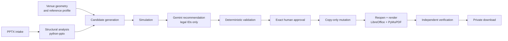

# DeckFit AI — Room-aware presentation preflight

Published source: **RC5.3 FINAL-01 r2**, imported from the qualified release archive. This repository preserves the application's existing provenance; it is not a claim that the software was newly written for this repository.

DeckFit checks supported editable PowerPoint text against room geometry, proposes bounded font scaling, requires exact human approval, and independently verifies the saved copy. It does not guarantee human readability or accessibility certification.

- [Release identity, qualification and operational limitations](docs/RELEASE_HANDOFF_RC53_R2.md)
- [FINAL-01 compatibility refusal policy](docs/FINAL01_COMPATIBILITY_POLICY.md)
- [Live DeckFit service](https://deckfit-ai-production.up.railway.app/) — separately checked on October 15, 2026; recheck source identity after any deployment.
- [This repository](https://github.com/saikiranpulagalla/deckfit-venue-preflight)

Gemini is optional. The demonstrated workflow used deterministic planning; no genuine Gemini invocation is claimed for this release evidence.

For local setup, install Python 3.12 and the dependencies in `backend/pyproject.toml`. Real rendering requires LibreOffice Impress, DejaVu fonts, and PyMuPDF. The existing Dockerfile supplies these Linux dependencies. Run `python scripts/compute_source_fingerprint.py` under Linux to check the source identity, and `python scripts/release_gate.py --full` for the complete unchanged test gate.

<details>
<summary>Historical README retained from the qualified source (older links and release claims are historical, not current deployment evidence)</summary>

**Next Founders Hackathon · Early startup MVP · Release candidate, not yet publicly deployed**

DeckFit AI helps recurring training presenters check *supported PowerPoint text-height geometry* against the actual screen height and farthest-viewer distance, review bounded candidate font changes, and download an independently checked copy after human approval.

It does **not** measure contrast, lighting, cognitive or individual readability, nor does it edit charts, images, diagrams, titles, or arbitrary slide content. Speaker notes and metadata are preserved, not sanitized. External linked resources are rejected at upload. Results near reference-band boundaries require care.

[Latest local QA and deployment handoff](docs/NEXT_FOUNDERS_QA_STAGE.md) · [Historical public app (may run an older build)](https://venue-agent-production.up.railway.app/) · [Repository](https://github.com/saikiranpulagalla/deckfit-ai) · [Next Founders release checklist](docs/NEXT_FOUNDERS_IMPLEMENTATION.md)

> **Source-of-truth warning:** Previous R8.1 and ForgeHacks public-run claims below describe **historical releases**, not this new source tree. New runtime/deployment claims require a fresh verified build and public check; this ZIP is not proof of live deployment.

## The problem

Presentation authors normally design at laptop distance, while audiences see a physically bounded display from real viewing distances. Existing tools understand the slide but do not make the venue's active image height and farthest viewer distance part of the design loop.

DeckFit AI makes those physical inputs explicit for a deliberately narrow, inspectable set of editable PowerPoint text. It does not claim universal readability, accessibility certification, AVIXA certification, or renderer equivalence with Microsoft PowerPoint.

## The solution

1. Upload a PPTX or start the project-owned demo.
2. Provide active display height and farthest viewing distance.
3. Analyze supported structural text against a versioned viewing-demand reference profile.
4. Generate deterministic, bounded repair candidates.
5. Let Gemini recommend only legal candidate selections.
6. Simulate and deterministically validate the proposed plan.
7. Require approval of the exact source, plan, constraints, and simulation snapshot.
8. Modify a copy of the PowerPoint—never the original.
9. Reopen, rerender, and independently verify the saved artifact.
10. Download the verified output or receive an explicit review/failure state.

## Why AI is meaningfully involved

Runtime model: operator-configured `GEMINI_MODEL`; default in source is `gemini-3.8-flash`. Gemini is optional and the deterministic planner remains available.

Gemini is a constrained planner, not an editor or verifier. It receives derived planning metadata: server-owned candidate IDs, candidate operation/scale, pre-simulation evidence, aggregate counts, and explicit constraints. It does **not** receive raw PPTX bytes, uploaded slide text, screenshots, or speaker notes in this competition build.

The model may return only `selected_candidate_ids` and a rationale. The server independently validates every selected ID, recomputes consequential state, requires human approval, applies only the already-approved bounded operation, and verifies the reopened saved file. Invalid, duplicate, late, or unsafe model output fails closed or uses the deterministic fallback. Gemini cannot invent a font size, rewrite slide text, modify a title, approve a plan, or declare a result verified.

## Architecture



- **FastAPI / Pydantic** provide the capability-protected API and state contracts.
- **python-pptx** inspects supported editable PowerPoint structure and performs the bounded copy-only mutation.
- **LibreOffice Impress** renders artifacts independently of structural predictions.
- **PyMuPDF** measures rendered PDF evidence.
- **Gemini** recommends from a finite set of server-approved, pre-simulated candidates.
- **The session store** isolates ephemeral artifacts and authorizes each operation with a session capability.

## What makes DeckFit AI different

- It treats the physical venue as an input to presentation design.
- AI chooses among constrained, pre-simulated repair options rather than generating editing commands.
- A human must approve the exact plan.
- The original PPTX is preserved; only a copy can be modified.
- Success is determined by reopening and independently verifying the saved artifact.
- Unsupported or uncertain content stays explicit and review-only instead of silently becoming a pass.

## Live demo

The current public service is [venue-agent-production.up.railway.app](https://venue-agent-production.up.railway.app/). It previously ran an R8.1 release under the historical internal service name **Venue Agent**; the current hosted version must be rechecked after deployment. This repository's documentation is newer public branding only; it does not assert that the deployed frontend was renamed.

Suggested judge path: **Try demo venue → Analyze → Inspect candidates → Plan → Approve → Apply → Verify → Download → Delete session**.

## Supported scope and limitations

The only supported automatic mutation is bounded `SCALE_TEXT` for eligible ordinary body text.

- Titles and headings are protected from automatic modification.
- Diagrams, images and image text, charts, SmartArt, tables, media, uncertain formatting, and ambiguously mapped content remain review-only.
- Semantic rewriting is not supported.
- `VERIFIED` means defined structural postconditions passed on the reopened saved artifact. It is not a claim about subjective readability for every person or an accessibility certification.

## Historical R8.1 technical validation (not a validation of this revision)

The following results apply to the validated **R8.1 runtime source**, release `r8.1-ab6a6752be613137`, digest `ab6a6752be613137c7565601d8a31d6194862776a709d72b70cdee0ae5759b73`:

- 186 tests collected; 150 non-resource tests passed.
- Mandatory isolated LibreOffice adversarial/resource tests passed.
- HTTP smoke, Python compilation, frontend syntax, and claim lint passed.
- A strict public deployment check passed with `gemini-3.5-flash-lite`.
- Five independent public planner sessions used Gemini with zero deterministic fallbacks.
- The downloaded PowerPoint SHA-256 matched the server's independently verified output SHA-256; deletion made the session inaccessible.

This GitHub publication changes documentation and public branding only. Its publication digest is recorded separately from the runtime digest; the historical runtime evidence is not silently reassigned to the modified documentation snapshot.

Current R8 evidence and limitations are retained in [validation/R8_RELEASE_STATUS.md](validation/R8_RELEASE_STATUS.md).

## Local installation and usage

Requirements: Python 3.11+; LibreOffice Impress is required for rendering and full artifact tests; Node.js is required for the frontend syntax check. Docker is the most reproducible route because the included image installs LibreOffice.

```bash
python -m venv .venv
# Windows PowerShell: .\.venv\Scripts\Activate.ps1
# macOS/Linux: source .venv/bin/activate
python -m pip install -e "./backend[dev,agent]"

# Start the API from the repository root.
python -m uvicorn app.main:app --app-dir backend --host 127.0.0.1 --port 8000
```

Open `http://127.0.0.1:8000` and use **Try demo venue**, or upload a supported PPTX. Set `GEMINI_API_KEY` only to enable the optional bounded Gemini planner; without it, deterministic planning remains available.

Run checks from the repository root:

```bash
python scripts/claim_lint.py
python scripts/check_frontend_js.py
python -m compileall -q backend/app scripts
python scripts/http_smoke.py
python scripts/release_gate.py --full
```

`release_gate.py --full` invokes LibreOffice-backed tests in isolated processes. Do not describe the full renderer gate as passed on a machine where LibreOffice is unavailable.

## Development history and AI disclosure

DeckFit AI builds on earlier engineering work internally named **Venue Agent**, including prior WCC-era foundations. During ForgeHacks, the project received release hardening, adversarial PPTX/renderer coverage, bounded Gemini provenance work, public deployment verification, and ForgeHacks-specific presentation material. The repository does not claim that every line originated during the event.

Development-time AI assistance (including OpenAI Codex) supported implementation, test review, and documentation. That assistance is separate from the runtime product: runtime Gemini receives only bounded derived metadata and has no authority to execute edits or verify outcomes. See [AI tool disclosure](docs/AI_TOOL_DISCLOSURE.md).

## Historical ForgeHacks submission (archived context)

- Event: **ForgeHacks Online 2026**
- Track: **AI + Creativity**
- Repository: [saikiranpulagalla/deckfit-ai](https://github.com/saikiranpulagalla/deckfit-ai)
- Live demo: [venue-agent-production.up.railway.app](https://venue-agent-production.up.railway.app/)
- Demo video: _public 2–4 minute link to be added before submission_

For a concise evaluator map, see [ForgeHacks judging map](docs/FORGEHACKS_JUDGING_MAP.md). For known boundaries, see [claims and limitations](docs/CLAIMS_AND_LIMITATIONS.md).

## License and notices

See [THIRD_PARTY_NOTICES.md](THIRD_PARTY_NOTICES.md) for third-party notices.

</details>
