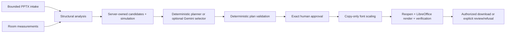

# DeckFit AI

### Prepare your slides for the actual room.

A deck that looks comfortable on a laptop can put small text on a distant classroom screen. DeckFit AI brings **active image height and farthest-viewer distance** into PowerPoint preflight, then offers a deliberately narrow repair workflow: simulate bounded font changes, get exact human approval, modify a copy, and independently verify the saved result.

Built for the customer hypothesis of **independent classroom trainers and small training organizations** delivering text-heavy decks repeatedly across different venues.

[Try the hosted demo](https://deckfit-ai-production.up.railway.app/) · [Run locally](#run-locally) · [Release evidence](#release-identity-and-evidence) · [Safety policy](docs/FINAL01_COMPATIBILITY_POLICY.md)

> **Scope, not a readability guarantee.** DeckFit evaluates supported text-height geometry against a versioned reference profile. It does not measure contrast, lighting, comprehension, individual vision, or overall accessibility, and does not certify a presentation. A hosted URL or release label is not proof of the running source; use the source-bound verifier below.

## The product in one minute

1. Start the built-in demo or upload a supported `.pptx`.
2. Enter the **active projected/displayed image height**, not the screen's diagonal, and the **farthest viewer distance**, in meters. Indicate whether measurements are measured or estimated.
3. Analyze the deck. Inspect below-target text, structural coverage, unsupported visible content, and candidate tradeoffs.
4. Generate a plan. Review the selected server-owned candidate IDs, scale factors, simulation evidence, rationale, and actual planner provenance.
5. Explicitly approve the exact current plan. Changing the analyzed inputs requires a fresh plan and approval.
6. Let DeckFit apply eligible changes to a copy, reopen it, render it with LibreOffice, and check the saved artifact.
7. Inspect the final state, download the output, and delete the session when finished.

For a reproducible starting example, use the built-in demo with **1.8 m image height** and **10.8 m farthest-viewer distance**. These are test inputs, not measurements of your room. Deterministic planning works without an API key.

## Why not just increase every font size?

Blind scaling can alter titles, cause overflow, or leave unsupported content outside the check. DeckFit connects the room measurements to an inspectable, bounded decision and checks the actual saved copy rather than declaring success from a proposed edit.

| Manual task | DeckFit's bounded contribution |
|---|---|
| Decide what “too small” means for this venue | Explicit room geometry and a versioned text-height reference |
| Decide which edits are acceptable | Server-generated, pre-simulated candidate choices |
| Keep control of the presentation | Exact human approval; original upload preserved |
| Check whether the edit really worked | Reopen, independent render, package and output verification |
| Decide what cannot be assessed | Explicit refusal or review-required outcomes |

This is a workflow distinction, not a claim that no competing tool offers similar capabilities.

## What is supported—and what is not

The only automatic edit is bounded **`SCALE_TEXT` on eligible supported body text with explicit font sizing**. DeckFit does not rewrite slide content or generally redesign presentations.

- Titles and headings are protected from automatic mutation.
- Charts, diagrams, SmartArt, tables, images/image text, media, ambiguous mappings, and uncertain formatting are not automatically repaired. Unsupported content can require review or refusal.
- Text, slide/package relationships, images, backgrounds, and notes must remain protected by the applicable integrity checks. Notes and metadata are preserved, **not sanitized**.
- External links and dangerous unsupported inputs are rejected under intake policy.
- A result near a reference boundary, outside the reference domain, or based on estimated measurements deserves additional human judgment.
- LibreOffice rendering is independent evidence, not a guarantee of identical Microsoft PowerPoint rendering. Open the downloaded copy in the intended presentation environment before use.

**What `VERIFIED` means:** the saved output passed the implemented structural, package, rendering, and coverage postconditions for the supported scope. It does not certify every visual property or every audience member's experience. `REVIEW_REQUIRED` is not a successful verification, and an HTTP 200 alone is not proof of a verified result. Completed outputs remain immutable within the session; replanning/reanalysis is rejected.

### FINAL-01: compatibility content fails closed

RC5.2 had a confirmed false-`VERIFIED` defect: visible objects inside `mc:AlternateContent` could escape the structural inventory. **Do not substitute RC5.2 for this release.**

RC5.3 FINAL-01 r2 rejects namespace-qualified compatibility wrappers anywhere in slide, layout, or master XML at intake, including relocated layout/master parts identified by content type. It does not trust `slide.shapes` traversal to discover them, select a branch, or flatten the file.

This deliberately rejects some legitimate presentations—including empty or metadata-only wrappers, hidden slides, and unused layouts/masters. The application will not silently normalize them. See the [compatibility policy](docs/FINAL01_COMPATIBILITY_POLICY.md) and [permanent regression tests](backend/tests/adversarial/test_final01_compatibility.py).

## Architecture and trust boundaries



FastAPI/Pydantic provide API and state contracts; python-pptx handles supported structure and bounded edits; LibreOffice Impress and PyMuPDF provide rendered evidence. The static frontend is served by the backend. Sessions are ephemeral and capability-protected.

### AI is an optional selector, never the authority

Gemini receives derived planning metadata: finite candidate IDs, permitted operations/scales, simulation evidence, aggregate counts, and constraints—not raw PPTX bytes, uploaded slide text, screenshots, or speaker notes in this build. It can recommend candidate IDs and a rationale; the server validates the choices. Gemini cannot invent an edit, approve a plan, execute mutations, or declare verification.

Timeouts, invalid responses, and provider failures have bounded handling and deterministic fallback. Inspect `planner_used`, `fallback_used`, and the displayed rationale rather than inferring provider success from a configured model name.

**Evidence boundary:** the qualified workflow used deterministic planning. Genuine Gemini execution is not established by that evidence. `.env.example` documents optional configuration; a configured model ID does not establish current provider availability, quota, or successful invocation. Never commit API keys.

## Run locally

### Recommended: the existing Linux container

Requirements: a running Docker engine and enough local resources for LibreOffice. From the repository root:

```bash
docker build -t deckfit-ai:rc53-r2 .
docker run --rm --name deckfit-local -p 127.0.0.1:8000:8000 deckfit-ai:rc53-r2
```

Open [http://127.0.0.1:8000](http://127.0.0.1:8000). No Gemini key is required. The Dockerfile uses Ubuntu 24.04, installs LibreOffice Impress and DejaVu fonts, enforces its configured Ubuntu LibreOffice security-package floor, and starts one Uvicorn worker as a non-root user. A new build resolves packages at build time; record the actual versions and image identity if reproducing a release.

In another terminal, inspect real health separately from process status:

```bash
docker inspect --format '{{.State.Health.Status}}' deckfit-local
curl --fail http://127.0.0.1:8000/health
curl --fail http://127.0.0.1:8000/health/readiness
curl --fail http://127.0.0.1:8000/health/deep-readiness
```

Stop the foreground container with Ctrl+C when finished. Its writable-layer session data is disposable.

### Native Python development

Use Python 3.12 to align with the container; the package declares Python 3.11+. Real repair verification also requires LibreOffice Impress, suitable fonts, and the installed PyMuPDF dependency. Node.js is needed for the frontend syntax check.

```bash
python -m venv .venv
source .venv/bin/activate
python -m pip install -e './backend[dev,agent]'
python -c "import app; print(app.__file__)"
python -m uvicorn app.main:app --app-dir backend --host 127.0.0.1 --port 8000 --workers 1 --no-access-log
```

PowerShell activation: `.\.venv\Scripts\Activate.ps1`. Verify that `app.__file__` resolves to this checkout's `backend/app`, not an unrelated installed `app` package. If LibreOffice is absent on Windows, use the Linux container for rendering; missing system software is not evidence that the renderer tests passed or failed on application behavior.

### Operational limits worth knowing before hosting

- **Exactly one worker and one replica.** Session ownership, expiry, capacity, and planner circuit-breaker state are process-local. This is not a durable multi-worker deployment.
- Sessions and undownloaded artifacts can be lost on restart, replacement, or expiry. Download important output before closing the workflow. Do not share a session root between independent instances.
- Treat a session capability as a credential: do not share it, expose request headers, or capture tokens in recordings. Avoid sensitive decks on a public demo.
- `/health` is liveness; readiness and deep readiness have separate prerequisite/rendering semantics. Do not equate “running” with “ready.”
- **Known frozen-image limitation:** Docker's native healthcheck targets port **8000**, while startup honors `PORT`. Setting `PORT=8080` can leave HTTP healthy but Docker-native health unhealthy. Use the default local port for this recipe; a source-level correction requires separately qualified release work.
- `railway.json` specifies deep readiness and a 180-second timeout, but effective Railway settings must be checked independently; do not assume legacy Config as Code loaded. This README does not change or authorize any production resource.

## Release identity and evidence

This repository publishes **RC5.3 FINAL-01 r2** application source from the qualified archive. README and repository-hygiene changes are publication metadata, not a newly qualified application build.

| Evidence | Exact identity or scope |
|---|---|
| Original candidate | `deckfit-ai-next-founders-rc5-3-final01-r2.zip` |
| Archive SHA-256 | `3d6bc28d81a5423f35d41b262bb9ba15885fcc5eb16b304dcfa8ff8e7df90479` |
| Linux/POSIX application-source fingerprint | `0d84f135419cdb1b9e3c5918fb04da5c40c4a9e591213c332f580670b43ead53` |
| Historical exact-archive local qualification, October 15, 2026 | 208 non-resource + 46 isolated renderer/resource tests = **254/254**, complete release gate passed |
| Publication checks before the initial push | 208 non-resource tests, claim lint, frontend syntax, and unchanged application-source identity passed |
| Provider evidence | Deterministic planning exercised; genuine Gemini invocation not established |

The historical complete gate is not a fresh run of every clone, current deployment, or newly resolved dependency environment. The original archive and external raw qualification bundle are **not included in this repository**. See the [release handoff](docs/RELEASE_HANDOFF_RC53_R2.md) for provenance and limitations; do not treat a documentation table as a substitute for raw logs.

A subsequent [independent FINAL-01 qualification](docs/FINAL01_INDEPENDENT_QUALIFICATION.md) reproduced the RC5.2 defect, confirmed r2 refusal, and reran the unchanged full gate: **254/254 passed**. The report links the newly published gate log, real HTTP outcomes and supplemental integrity checks. This is local qualification, not a fresh production acceptance.

Compute the application fingerprint on Linux/POSIX:

```bash
python scripts/compute_source_fingerprint.py
```

The unchanged fingerprint algorithm sorts native paths: Windows can produce a different value from identical bytes. The ZIP SHA-256 is the cross-platform distribution identity. The source fingerprint covers a defined subset, **not** every repository file, resolved dependencies, an image digest, or a signed deployment attestation. Verify those identities separately.

### Reproduce the checks

From the repository root with development dependencies installed, on Linux:

```bash
export PYTHONPATH="$PWD/backend"
python -c "import app; print(app.__file__)"
python scripts/claim_lint.py
python scripts/check_frontend_js.py
python -m pytest backend/tests -m 'not resource' -q
python scripts/release_gate.py --full
```

PowerShell import isolation: `$env:PYTHONPATH = (Resolve-Path ./backend).Path` before invoking pytest. The complete gate runs renderer/resource cases in isolated processes and requires actual LibreOffice. Do not increase timeouts, omit failing cases, or count a stalled run as a pass. A normal container build installs runtime dependencies, not the full development-test toolchain.

### Verify a running instance independently

With the local application running, execute from the checkout:

```bash
python scripts/live_deployment_check.py \
  --base-url http://127.0.0.1:8000 \
  --expected-source-fingerprint 0d84f135419cdb1b9e3c5918fb04da5c40c4a9e591213c332f580670b43ead53 \
  --full
```

For an authorized hosted check, replace only the base URL. The full verifier creates and deletes its own demo session, exercises real repair and download checks, and fails on an unexpected source identity. Inspect the script for its exact assertions; separately exercise FINAL-01 refusal and any acceptance checks beyond its coverage. Add `--require-gemini` only when deliberately requiring real Gemini provenance; deterministic fallback must not be reported as a provider success.

For production acceptance, also record actual deployment/image identities, runtime package versions, effective healthcheck and replica settings, public browser behavior, and sanitized logs. A source hash reported by a server is useful evidence, not protection against a dishonest server.

## Startup hypothesis and evidence to collect

The initial buyer hypothesis is a recurring training provider: reuse of a text-heavy deck across rooms may make venue-specific preflight more valuable than a one-off slide edit. This is **not validated demand, traction, or proven willingness to pay**.

Evaluate a free supported-deck trial, per-deck credits, and monthly trainer credits before setting prices. Measure supported-upload rate, repairable-upload rate, successful completion, time to result, review/refusal reasons, repeat use, and attributable support effort. Ask trainers to compare the workflow with their current process; record consented observations, not invented testimonials.

```text
Contribution per successful supported deck
  = collected revenue
  - compute - AI provider cost - storage/network
  - attributable support - payment costs
```

Refused or unrepairable uploads still consume intake/analysis/support resources. Allocate those costs across successful decks and test sensitivity to the supported-and-repairable fraction; do not assume every upload earns revenue. No price, revenue, savings, or customer result is asserted here.

## A truthful five-minute Next Founders demo

Give technical execution, innovation/UX, business/finance, and communication visible evidence—not just a test-count slide.

- **0:00–0:35 — Problem and buyer:** show the room measurements and explain the recurring-trainer hypothesis.
- **0:35–2:00 — Working product:** run the supported demo, inspect candidates, approve the exact plan, and download the actual result.
- **2:00–3:05 — Technical safety:** explain bounded choices, independent verification, output-hash binding, and the FINAL-01 refusal. Show what the product will not claim.
- **3:05–4:10 — Business:** distinguish measured technical outcomes from unvalidated buyer assumptions; show the unit-economics inputs still to measure.
- **4:10–4:45 — Scalability:** acknowledge today's single-instance ephemeral architecture. Durable ownership and isolated renderer workers are future engineering, not implemented scale claims.
- **4:45–5:00 — Outcome:** show the final server state and downloaded artifact; state whether planning was deterministic or genuinely provider-backed.

Use a real recording and sanitize capabilities/credentials. Do not present deterministic fallback as Gemini, a review result as `VERIFIED`, or local evidence as public deployment proof.

## Repository map and provenance

- [`backend/app`](backend/app) — intake/security, sessions, planner, PPTX operations, simulation, and verification.
- [`backend/tests`](backend/tests) — unit, adversarial, API, and renderer/resource regressions.
- [`frontend/static/index.html`](frontend/static/index.html) — browser workflow and planner provenance.
- [`scripts`](scripts) — release gate, identity, smoke, claim, and live verification tools.
- [`reference`](reference) and [`demo`](demo) — versioned reference data and project demo.
- [`docs/RELEASE_HANDOFF_RC53_R2.md`](docs/RELEASE_HANDOFF_RC53_R2.md) — current publication scope and limitations.

DeckFit builds on earlier work internally named **Venue Agent**, including prior WCC-era foundations and ForgeHacks hardening. The new repository is not a claim that all software originated here or during Next Founders. Historical R8/ForgeHacks documents remain for provenance and regression contracts; their results are not reassigned to r2. See [historical R8 evidence](validation/R8_RELEASE_STATUS.md), [AI development-tool disclosure](docs/AI_TOOL_DISCLOSURE.md), and [claims and limitations](docs/CLAIMS_AND_LIMITATIONS.md).

Development-time AI assistance is separate from runtime Gemini execution. Third-party notices are retained in [THIRD_PARTY_NOTICES.md](THIRD_PARTY_NOTICES.md); those notices do not themselves grant a license to this project's code.
